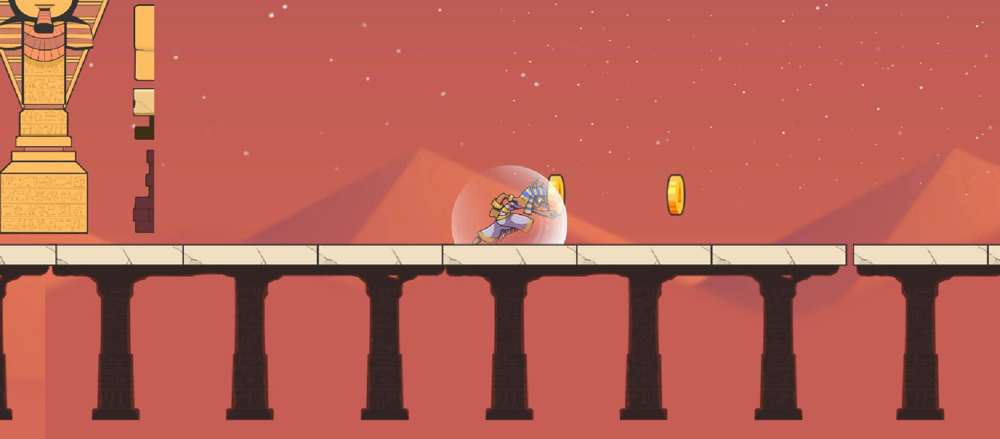

# Endless Runner

A 2D platformer made in Unity, set in an Egyptian desert world. Run and jump across platforms and bridges, dodge hazards, and collect items on your way through the level.


## Features

- 2D platforming with a pharaoh-themed character
- Desert level with platforms, scaffolding, bricks, and pillars
- Collectible items
- Built for Windows

## Controls

| Action | Key |
|--------|-----|
| Move left / right | A / D or Arrow Keys |
| Jump | Space |

> Update this table to match your actual controls.

## Getting Started

### Play the game

1. Download the latest build from the **Releases** page (or the `Builds` folder).
2. Unzip the whole folder.
3. Run the `.exe` file.

### Open the project in Unity

1. Install [Unity Hub](https://unity.com/download).
2. Install **Unity 6** (the project was made with Unity 6.2 or newer; check `ProjectSettings/ProjectVersion.txt` for the exact version).
3. Clone this repository:
   ```
   git clone https://github.com/your-username/your-repo.git
   ```
4. In Unity Hub, click **Add > Add project from disk** and select the cloned folder.
5. Open the scene `Assets/Scenes/newone` and press **Play**.

## Project Structure

```
Assets/
  Scenes/       Game scenes (newone is the main level)
  Scripts/      Game code
  Prefabs/      Reusable objects (platforms, items, etc.)
  Art/          Sprites and visuals
  Materials/    Materials
  Settings/     Project settings assets
Packages/       Unity package dependencies
ProjectSettings/
```

## Build

1. Go to **File > Build Profiles**.
2. Select **Windows** and make sure `Scenes/newone` is index 0 in the Scene List.
3. Click **Build** and choose an empty folder.

## Credits

- Made by: mohamad hammoude
- Art assets: assets store 2D
- Fonts and plugins: TextMesh Pro

## Output




